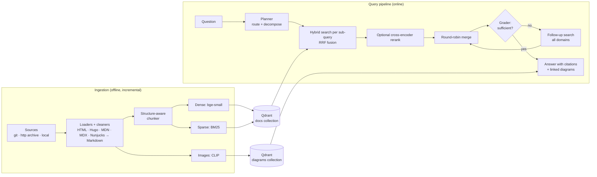

# RAG Search Engine

**Agentic retrieval-augmented generation over real technical documentation**:
Python, Go, JavaScript, React, React Native, Kubernetes, backend system design
and frontend system design. It combines hybrid search, optional cross-encoder reranking,
multimodal diagram search, self-correcting retrieval and cited answers, served
through a streaming REST API and measured by an evaluation harness.

| Corpus                                    |                                                   |
| ----------------------------------------- | ------------------------------------------------- |
| Knowledge domains                         | 8                                                 |
| Sources                                   | 13 (git repos, an HTTP archive)                   |
| Documents                                 | 2,820                                             |
| Chunks (dense + BM25 vectors)             | 26,707                                            |
| Indexed diagrams (CLIP)                   | 523                                               |
| Full ingestion, CPU only (Apple M-series) | ~60 min, incremental re-run with no changes: 26 s |

```text
$ python main.py ask "How should a Python service shut down gracefully when Kubernetes terminates its Pod?"
domains: python, kubernetes | queries: ['Python graceful shutdown SIGTERM signal handler',
  'Kubernetes Pod termination lifecycle preStop hook terminationGracePeriodSeconds',
  'Python asyncio graceful shutdown on SIGTERM'] | rounds: 1

### 1. Kubernetes Termination Flow
3. If a `preStop` hook is defined, it executes **before** the `TERM` signal is sent [3][7].
4. The kubelet sends a `SIGTERM` signal to process 1 (PID 1) inside the container [3].
5. The container has `terminationGracePeriodSeconds` (default 30s) to finish. If the
   process does not exit by then, it is killed with `SIGKILL` [3][9].

### 2. Python Signal Handling
Use `loop.add_signal_handler()` to catch `SIGTERM` ... [2]
```

## Why this project is interesting

| Challenge                                                                                                                         | How it is handled                                                                                                                                                                                                                                                       |
| --------------------------------------------------------------------------------------------------------------------------------- | ----------------------------------------------------------------------------------------------------------------------------------------------------------------------------------------------------------------------------------------------------------------------- |
| Thirteen sources in five markup dialects: Sphinx HTML, Hugo shortcodes, MDN KumaScript macros, MDX/JSX, Nunjucks and Go templates | Cleaners _render_ each site's templating into plain Markdown rather than deleting it: `{{jsxref("Promise")}}` becomes `Promise`, `<Pitfall>` becomes **Pitfall:**, and Mermaid is kept as diagrams-as-code. They never touch code fences, so JSX `style={{…}}` survives |
| Long, deeply structured pages                                                                                                     | **Structure-aware chunking**: splits on the heading tree, never cuts code blocks, merges tiny sections, and prefixes each chunk with its breadcrumb (_contextual chunk headers_)                                                                                        |
| Exact identifiers (`kubectl rollout undo`, `functools.lru_cache`) vs. paraphrased questions                                       | **Hybrid retrieval**: BM25 sparse + BGE dense vectors, fused with Reciprocal Rank Fusion inside Qdrant                                                                                                                                                                  |
| Precision of the final context                                                                                                    | **Cross-encoder reranking**, available per request. It is _off by default_ because the ablation below showed it did not beat hybrid search on this corpus and cost 0.9–3.7 s per query on CPU                                                                           |
| Questions spanning domains ("asyncio service on Kubernetes that autoscales")                                                      | **Query planner** routes to domains and decomposes into sub-queries, a round-robin merge guarantees every sub-question is represented                                                                                                                                   |
| Wrong routing / missing context                                                                                                   | **Self-correction (CRAG-style)**: an LLM grades the context and triggers a widened follow-up search when it is insufficient                                                                                                                                             |
| Diagram-heavy system design content (500+ architecture diagrams)                                                                  | **Multimodal**: diagrams are resolved locally or downloaded and cached once, then embedded with CLIP. Each is linked to the chunks that reference it, returned with answers, and searchable by text or by uploading an image                                            |
| "Is it actually good?"                                                                                                            | **Evaluation harness**: Hit@k / Recall@k / MRR / nDCG@k on a labelled golden set, ablations (BM25 vs dense vs hybrid vs +rerank), LLM-as-judge faithfulness and relevance with a _different_ model family                                                               |
| Running it for real                                                                                                               | FastAPI with SSE streaming, request IDs, JSON logs, health checks, incremental idempotent ingestion, Docker + Qdrant server, typed config with env overrides, offline-first model loading, per-step model routing to stay within free-tier rate limits, 55 tests        |

## Architecture



The query loop is **bounded** (`agent.max_retrieval_rounds`), so latency and
cost stay predictable, and every step is recorded in a trace returned by the
API. Each LLM step **fails open**: if the planner or grader is unavailable the
pipeline degrades to plain hybrid retrieval instead of failing the request.

## Tech stack

| Layer               | Choice                                                                                                                   | Why                                                                          |
| ------------------- | ------------------------------------------------------------------------------------------------------------------------ | ---------------------------------------------------------------------------- |
| Vector DB           | **Qdrant** (embedded for dev, server in Docker for prod)                                                                 | Native dense + sparse vectors, server-side RRF fusion, payload filtering     |
| Embeddings          | `BAAI/bge-small-en-v1.5` (dense), `Qdrant/bm25` (sparse), `clip-ViT-B-32` (images) via **FastEmbed**                     | ONNX Runtime: no PyTorch, small image, fast CPU inference                    |
| Reranker (optional) | `Xenova/ms-marco-MiniLM-L-6-v2`, `bge-reranker-base` and `jina-reranker-v1-turbo-en` also evaluated                      | Kept for experiments, off by default (see Evaluation)                        |
| LLM                 | Answers: Groq `qwen3.8-27b` → `gpt-oss-120b` → OpenRouter. Planner/grader: Groq `gpt-oss-20b`. Any OpenAI-compatible API | Free tiers, provider failover, retries with back-off, per-step model routing |
| API                 | FastAPI + Uvicorn, Server-Sent Events                                                                                    | Typed schemas, OpenAPI docs at `/docs`                                       |
| Config              | YAML + Pydantic Settings, `RAG_*` env overrides                                                                          | Validated at start-up, secrets only in `.env`                                |
| Quality             | pytest, Ruff, Pyright                                                                                                    | `make check`                                                                 |

## Quickstart

Requires Python 3.12+, [uv](https://docs.astral.sh/uv/) and Docker (for the Qdrant server).

```bash
uv sync                                  # install
cp .env.example .env                     # add a free GROQ_API_KEY (console.groq.com),
                                         # QDRANT_URL=http://localhost:6333 is preset
docker compose up -d qdrant              # Qdrant server on :6333 (dashboard: /dashboard)
uv run python main.py ingest             # download + index all docs (~1 h first time on CPU, then incremental)
uv run python main.py ask "How does a Kubernetes Service load-balance traffic to Pods?"
uv run python main.py serve              # API on http://localhost:8000/docs
```

To run the API in Docker as well, use `docker compose up -d api`. The first
start downloads about 600 MB of models into a volume.

Without Docker, leave `QDRANT_URL` empty and Qdrant runs **embedded**
(`data/qdrant`). That is fine for experiments, but it is single-process and
Qdrant recommends a server above about 20k points, this corpus has 26.7k.

## Usage

### CLI

| Command                                                                | What it does                                                                                |
| ---------------------------------------------------------------------- | ------------------------------------------------------------------------------------------- |
| `main.py ingest [-d python] [--refresh] [--recreate]`                  | Incremental ingestion: unchanged documents are skipped (content hash), deleted ones removed |
| `main.py ask "..." [-d kubernetes] [--no-stream] [--trace]`            | Full agentic pipeline with streamed answer, sources and diagrams                            |
| `main.py search "..." [--mode dense\|sparse\|hybrid] [--no-rerank]`    | Retrieval only — no LLM, for debugging                                                      |
| `main.py diagrams "cache in front of database"` / `--image sketch.png` | Multimodal diagram search                                                                   |
| `main.py eval [--ablation] [--agentic] [--generation]`                 | Evaluation on `eval/golden_set.json`, reports saved to `eval/reports/`                      |
| `main.py stats`                                                        | What is indexed                                                                             |

### REST API

| Endpoint                            | Description                                                                  |
| ----------------------------------- | ---------------------------------------------------------------------------- |
| `POST /v1/ask`                      | Answer + citations + diagrams + plan + per-step trace                        |
| `POST /v1/ask/stream`               | Same, as Server-Sent Events: `plan`, `sources`, `diagrams`, `token`…, `done` |
| `POST /v1/search`                   | Retrieval only (mode / rerank overridable)                                   |
| `POST /v1/diagrams/search`          | Text → diagram (CLIP)                                                        |
| `POST /v1/diagrams/search-by-image` | Image upload → similar diagrams                                              |
| `GET /v1/domains` · `GET /health`   | Domains with document counts · liveness/readiness                            |

```bash
curl -N localhost:8000/v1/ask/stream -H 'content-type: application/json' \
     -d '{"question": "When should I use write-through vs write-behind caching?"}'
```

## Evaluation

`eval/golden_set.json` holds 51 hand-labelled questions across all eight
domains in five categories (factual, how-to, exact-identifier, design,
cross-domain), each with the
documentation pages that answer it. Metrics are computed at document level.

### Retrieval (51 questions, k = 5, document-level)

| Strategy                                            | Hit@5     | Recall@5  | MRR       | nDCG@5    | p50 latency |
| --------------------------------------------------- | --------- | --------- | --------- | --------- | ----------- |
| BM25 only                                           | 0.902     | 0.755     | 0.788     | 0.703     | 1 ms        |
| Dense only (bge-small)                              | 0.980     | 0.845     | 0.889     | 0.820     | 10 ms       |
| Hybrid (dense + BM25, RRF)                          | 0.961     | 0.842     | 0.860     | 0.794     | 10 ms       |
| Hybrid + MiniLM cross-encoder                       | 0.961     | 0.845     | 0.814     | 0.776     | 906 ms      |
| Hybrid + bge-reranker-base                          | 0.961     | 0.871     | 0.827     | 0.804     | 3,710 ms    |
| Hybrid + jina-reranker-v1-turbo                     | 0.941     | 0.796     | 0.886     | 0.789     | 1,211 ms    |
| Agentic, large planner (`qwen3.8-27b`)              | **1.000** | **0.897** | **0.890** | **0.842** | see below   |
| **Agentic, small planner (`gpt-oss-20b`, default)** | 0.980     | 0.876     | 0.886     | 0.828     | see below   |

MRR by question type:

| Strategy                         | Factual   | How-to    | Identifier | Design    | Cross-domain |
| -------------------------------- | --------- | --------- | ---------- | --------- | ------------ |
| BM25 only                        | 0.590     | 0.753     | 0.917      | **1.000** | 0.500        |
| Dense only                       | **0.917** | **0.885** | **1.000**  | 0.857     | **0.708**    |
| Hybrid                           | 0.903     | 0.769     | 0.938      | 0.964     | 0.500        |
| Agentic, large planner           | 0.903     | 0.846     | 0.938      | 0.946     | **0.708**    |
| Agentic, small planner (default) | 0.903     | 0.846     | 0.938      | 0.952     | 0.625        |

What the numbers say:

- **No single retriever wins everywhere.** BM25 is perfect on system-design
  questions (distinctive terms) but weak on paraphrased factual ones, dense is
  the reverse. Hybrid fusion is the robust middle ground.
- **Single-shot retrieval fails on multi-part questions** (cross-domain MRR
  0.50 for hybrid). The planner's sub-queries recover them: 0.63 with the
  default small planner, 0.71 with the larger one. With the larger planner,
  the agentic pipeline is the only configuration that finds a relevant page
  for every question (Hit@5 = 1.00).
- **Planner size is a quality/throughput trade-off.** The small planner loses
  a little decomposition quality (roughly one cross-domain question, given only
  four) but keeps the answer model's rate-limit budget free. Switch with
  `llm.fast_providers` in `config.yaml`.
- **Cross-encoder reranking did not pay off here.** None of the three
  rerankers beat the un-reranked baselines on MRR, and they cost 0.9–3.7 s per
  query on CPU, so reranking is off by default (`retrieval.rerank.enabled`).
- **Latency.** Retrieval is ~10 ms. An end-to-end `/v1/ask` (plan → retrieve
  → grade → generate) takes ~3.3 s on Groq's free tier. That was 84 s before
  planning and grading moved to a separate small model, because every step
  queued on one model's 7k tokens-per-minute budget.

Caveats: 51 questions is a small set (one question moves MRR by ~0.02), and
labels are document-level. The labels were extended when new sources were
added, chosen by topic, not by which system retrieved them.

### Answer quality (LLM-as-judge, 15 questions)

| Metric                                                        | Result           |
| ------------------------------------------------------------- | ---------------- |
| Faithfulness: claims supported by the retrieved sources (1–5) | 5.0              |
| Answer relevance vs. reference answer (1–5)                   | 5.0              |
| Answers containing at least one citation                      | 100%             |
| Corrective retrieval rounds triggered                         | 13% of questions |
| Errors                                                        | 0                |

Read these as a smoke test rather than a benchmark. Every answer received
the top score, a ceiling effect typical of LLM judges, and the 15 questions are
the first 15 of the set (Python and Kubernetes only). Partway through the run
Groq's free-tier _daily_ token cap for the answer model was reached, so some
answers fell back to `gpt-oss-120b`, the judge's own model family. Retrieval
metrics are the more trustworthy signal, a larger, human-spot-checked
generation eval is listed in the roadmap.

Reproduce with `uv run python main.py eval --ablation` (retrieval, no LLM
needed) and `uv run python main.py eval --agentic --generation` (planner +
answers graded by `gpt-oss-120b`, a different model family from the generator
to avoid self-preference bias).

## Project structure

```text
├── main.py                  # CLI entry point (Typer)
├── config.yaml              # all non-secret settings, incl. knowledge domains
├── .env.example             # API keys / QDRANT_URL template
├── src/rag/
│   ├── config.py            # typed settings (YAML + env overrides)
│   ├── container.py         # composition root: wires every service once
│   ├── models.py            # Document, Chunk, RetrievedChunk, Diagram
│   ├── ingestion/           # sources (git/http/local) · cleaners (per-site markup) ·
│   │                        #   images (diagram resolve/download) · loaders · incremental pipeline
│   ├── chunking/            # structure-aware Markdown chunker
│   ├── embeddings/          # dense / sparse / CLIP encoders (FastEmbed, ONNX)
│   ├── vectordb/            # Qdrant store: schema, upserts, hybrid + image search
│   ├── retrieval/           # retriever, cross-encoder reranker, diagram search
│   ├── prompts/             # versioned prompt templates
│   ├── llm/                 # OpenAI-compatible client with provider fallback
│   ├── pipeline/            # planner, grader, bounded agentic RAG loop
│   ├── evaluation/          # metrics, golden-set runner, LLM judge
│   ├── api/                 # FastAPI app, routes, schemas
│   └── utils/               # logging (JSON lines), tracing, hashing
├── tests/                   # unit + integration tests (no network needed)
├── eval/golden_set.json     # labelled evaluation questions
├── logs/                    # rotating JSON logs
└── Dockerfile · docker-compose.yml · Makefile
```

## Adding a knowledge domain

Domains are configuration, not code. Append to `config.yaml`:

```yaml
- name: terraform
  description: Terraform language, providers, state management and modules.
  sources:
    - name: terraform-docs
      kind: git
      location: https://github.com/hashicorp/web-unified-docs.git
      format: markdown
      include: ["content/terraform/**/*.mdx"]
      url:
        {
          base: "https://developer.hashicorp.com/terraform/",
          strip_prefix: "content/terraform/",
        }
```

then `python main.py ingest -d terraform`. The planner picks the new domain up
from its description automatically.

## Design decisions

- **Bounded agentic loop rather than a free-form agent.** Planning, grading
  and corrective search cover the common failure modes of single-shot RAG
  (multi-part questions, wrong routing, thin context) with at most
  `1 + max_retrieval_rounds` LLM calls before generation.
- **The original question is always searched** alongside the planner's
  sub-queries, so a bad rewrite can only add context, never remove it.
- **Fusion in the database.** Qdrant fuses dense and BM25 results (RRF) server
  side in a single request (~10 ms p50 over 26.7k chunks).
- **Measure before adding complexity.** The cross-encoder reranker is
  implemented and evaluated, but disabled by default because the data did not
  justify its latency (see Evaluation).
- **Per-step model routing.** Planning and grading produce short JSON and run
  on a small model with its own rate-limit budget, the larger model is kept
  for answers. On Groq's free tier the binding constraint is tokens per minute,
  not latency.
- **Idempotent ingestion.** Point IDs are deterministic (UUIDv5 of document +
  chunk index) and each document stores a hash of its text _and_ of the
  chunking/embedding settings, so changing a model or chunk size re-indexes
  exactly what is affected.
- **Prompt-injection hygiene.** Retrieved text is wrapped in `<source>` tags
  and declared to be data, answers must cite sources and admit missing info.

## Roadmap

- Tool-using agent: `Retriever.search`, `DiagramSearch` and the domain list
  are already self-contained and can be exposed as tools to an agent loop
  (e.g. adding web search or code execution).
- Conversation memory (follow-up questions) and semantic answer caching.
- Larger generation eval across all domains, with human spot checks and a
  judge from a provider not used for generation.
- Parent-document expansion (retrieve small chunks, send whole sections).
- OpenTelemetry export of the existing per-step traces.

## Development

```bash
make check        # ruff + pyright + pytest
make eval         # retrieval ablation
```

## Knowledge domains and data

| Domain                   | Sources                                                                                                                              | Licence                                        |
| ------------------------ | ------------------------------------------------------------------------------------------------------------------------------------ | ---------------------------------------------- |
| `python`                 | Python 3 docs: tutorial, library, reference, HOWTOs, FAQ                                                                             | PSF                                            |
| `golang`                 | go.dev docs (Effective Go, modules, GC guide, fuzzing, tutorials), language spec, memory model                                       | BSD-3-Clause                                   |
| `javascript`             | MDN JavaScript guide and reference, plus key Web APIs (fetch, workers, IndexedDB, WebSockets…)                                       | CC BY-SA 2.5                                   |
| `react`                  | react.dev: Learn and API reference                                                                                                   | CC BY 4.0                                      |
| `react_native`           | reactnative.dev docs                                                                                                                 | MIT / CC BY 4.0                                |
| `kubernetes`             | kubernetes.io concepts and tasks                                                                                                     | CC BY 4.0                                      |
| `system_design`          | System Design Primer, ByteByteGo _system-design-101_, karanpratapsingh/_system-design_                                               | CC BY-SA 4.0, CC BY-NC-ND 4.0, CC BY-NC-ND 4.0 |
| `frontend_system_design` | Front End Interview Handbook (system design), devkodeio frontend-system-design, web.dev (rendering, performance, PWA, accessibility) | MIT, MIT, CC BY 3.0                            |

All documents are downloaded at ingestion time into `data/raw` and are **not
redistributed** by this repository. The two CC BY-NC-ND sources are indexed
for personal, non-commercial use only. Remove them from `config.yaml` for any
commercial deployment.
